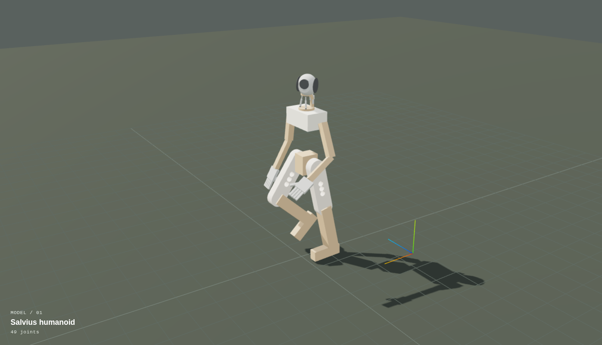

# Salvius 3D Model

This repository contains 3D modeling resources related to the [Salvius](http://salvius.org) robot.



## URDF

The main document in this repository is a URDF [(Unified Robot Description Format)](https://wiki.ros.org/urdf/XML) file intended to represent the current build of Salvius. This file is new and still in the process of being validated and refined as we revise both its details and the general implementation described in the [Salvius specification](https://salvius.org/spec/).

## Viewer

A standalone viewer can be accessed in the `viewer` directory. It currently loads the URDF model and provides a limited set of interactive and animation features for previewing the model. It can be run and viewed via:


```bash
cd viewer
sudo docker compose up -d
# (Serving on http://localhost:8080)
```
